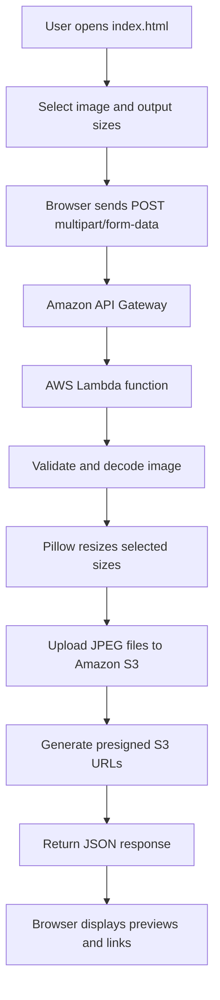
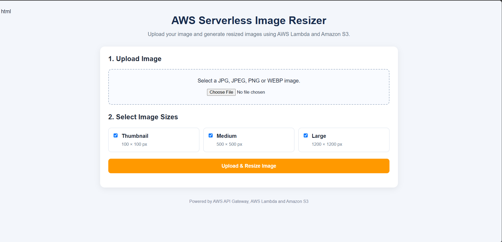

# AWS Serverless Image Resizer

A serverless web application that accepts an image, resizes it into selected dimensions, stores the generated images in Amazon S3, and returns temporary download links.

> **Project status:** Built with HTML, CSS, JavaScript, Python, AWS Lambda, Amazon API Gateway, and Amazon S3.

## Table of Contents

- [Overview](#overview)
- [Features](#features)
- [Architecture and Workflow](#architecture-and-workflow)
- [Image Sizes](#image-sizes)
- [Technology Stack](#technology-stack)
- [Project Structure](#project-structure)
- [How the Application Works](#how-the-application-works)
- [Setup and Deployment](#setup-and-deployment)
- [Screenshots](#screenshots)
- [Troubleshooting](#troubleshooting)
- [Security Notes](#security-notes)
- [Future Improvements](#future-improvements)

## Overview

The AWS Serverless Image Resizer demonstrates how a browser-based frontend can call an API Gateway endpoint that invokes an AWS Lambda function. The function validates the uploaded image, creates the selected output sizes using Pillow, stores JPEG outputs in Amazon S3, and returns presigned URLs.

The browser frontend is a static `index.html` file. The backend runs on AWS Lambda, so a dedicated always-on application server is not required.

## Features

- Upload supported JPG, JPEG, PNG, and WEBP images.
- Select one or more output sizes: thumbnail, medium, and large.
- Validate image data before processing.
- Resize and crop images to the configured dimensions.
- Convert output images to JPEG.
- Store generated images in Amazon S3.
- Return presigned S3 URLs for temporary access to resized images.
- Display image previews and open/download links in the browser.
- Return JSON responses and CORS headers from the Lambda function.

## Architecture and Workflow



### Request flow

1. The user selects an image and the desired sizes in the website.
2. JavaScript sends a `POST` request to the API Gateway `/upload` route using `multipart/form-data`.
3. API Gateway invokes the Lambda function.
4. Lambda reads the uploaded file and selected size names.
5. Pillow validates, crops, and resizes the image.
6. Boto3 uploads each output JPEG to the configured S3 bucket.
7. Lambda generates a presigned URL for each output object.
8. The frontend displays the returned links.

## Image Sizes

| Size | Dimensions | S3 key pattern |
|---|---:|---|
| Thumbnail | 100 × 100 px | `resized/thumbnail/<filename>.jpg` |
| Medium | 500 × 500 px | `resized/medium/<filename>.jpg` |
| Large | 1200 × 1200 px | `resized/large/<filename>.jpg` |

The Lambda code uses `ImageOps.fit`, which crops the image as needed to fill the exact output dimensions. Output files are saved as JPEG with quality set to 85.

## Technology Stack

| Technology | Purpose |
|---|---|
| HTML | Frontend structure |
| CSS | Page styling and responsive layout |
| JavaScript | File selection, API request, and result rendering |
| Python | Backend processing |
| Pillow (PIL) | Image validation and resizing |
| Boto3 | AWS S3 operations |
| Amazon API Gateway | HTTP API endpoint |
| AWS Lambda | Serverless image processing |
| Amazon S3 | Storage for resized output images |

## Project Structure

```text
serverless-image-resizer/
├── index.html
├── lambda_function.py
├── requirements.txt
├── README.md
└── screenshots/
    ├── website.png
    └── resized-results.png
```

The `screenshots/` folder is optional. Add your own screenshots and update the image names in this README to match the files you actually save.

## How the Application Works

### Frontend request

The website sends a `FormData` request with these fields:

- `file`: the image file.
- `sizes`: a JSON array, for example `["thumbnail","medium","large"]`.

The browser should set the request method to `POST` and allow the browser to set the multipart `Content-Type` header and its boundary automatically.

### Lambda processing

The Lambda function:

- Reads multipart form data or supported JSON/base64 input.
- Accepts `.jpg`, `.jpeg`, `.png`, and `.webp` filenames.
- Validates that the uploaded bytes represent an image.
- Resizes only the requested supported sizes.
- Uploads the resulting JPEG files to the configured S3 bucket.
- Returns a JSON response containing a message and an `images` object with presigned URLs.

### Example response shape

```json
{
  "message": "Images resized successfully.",
  "images": {
    "thumbnail": "PRESIGNED_S3_URL",
    "medium": "PRESIGNED_S3_URL",
    "large": "PRESIGNED_S3_URL"
  }
}
```

The URLs above are placeholders, not working links. Actual URLs are generated at runtime and expire after one hour in the supplied Lambda code.

## Setup and Deployment

### 1. Frontend

1. Open `index.html` in a code editor.
2. Set the API URL in the JavaScript to your deployed API Gateway endpoint, including the `/upload` path when that route is configured.
3. Run the page with a local development server, such as VS Code Live Server, or deploy it to a static hosting service.
4. Ensure the API Gateway CORS configuration allows the frontend's origin, the `POST` method, and the required `Content-Type` header.

### 2. Lambda function

1. Create or open the Lambda function in AWS.
2. Add the contents of `lambda_function.py`.
3. Package and provide the required Python dependencies, including Pillow, if they are not already available in the runtime.
4. Configure the `OUTPUT_BUCKET` value in the code to the intended output bucket.
5. Give the Lambda execution role permission to upload objects and generate access URLs for objects in that bucket.
6. Set suitable memory, timeout, and temporary-storage settings for the image sizes you intend to support.
7. Deploy the function and check its CloudWatch logs during testing.

### 3. API Gateway

1. Configure a `POST /upload` route connected to the Lambda function.
2. Configure CORS for the website's origin, `POST`, `OPTIONS`, and the `Content-Type` header.
3. Deploy or update the API stage if required by the API type.
4. Confirm that the frontend API URL matches the deployed API endpoint and route.

### 4. S3 output bucket

1. Create or use the output bucket configured in Lambda.
2. Keep the bucket private unless there is a specific, reviewed reason to make objects public.
3. Ensure the Lambda execution role has the minimum S3 permissions required.
4. Test the returned presigned links before considering the deployment complete.

> AWS Console labels and deployment steps can differ depending on the API Gateway type and AWS console version.

## Screenshots

Screenshots make a GitHub project easier to understand. Capture your actual running application and add the image files to a `screenshots/` directory.

### Website upload screen

Save a screenshot as `screenshots/website.png`, then uncomment the line below:



### Resized image results

Save a screenshot showing the generated image sizes and links as `screenshots/resized-results.png`, then uncomment the line below:

<!--  -->

### AWS architecture

The workflow diagram above is rendered from Mermaid by GitHub. It does not require a separate image file.

## Troubleshooting

| Problem | Things to check |
|---|---|
| Browser reports a CORS error | Confirm API Gateway CORS settings, the page origin, and the `POST`/`OPTIONS` methods. |
| HTTP 404 | Check the API ID, stage URL, and `/upload` route path. |
| HTTP 500 | Inspect Lambda CloudWatch logs and check dependencies, bucket name, permissions, and timeout. |
| Image upload cannot be parsed | Ensure the frontend sends `FormData` fields named `file` and `sizes`. Do not manually set the multipart `Content-Type` header in JavaScript. |
| S3 access denied | Check the Lambda execution role and bucket policy. |
| Presigned link does not open | Check the URL expiry, object permissions, region, and bucket configuration. |
| Pillow import error | Package a compatible Pillow build or configure an appropriate Lambda layer. |

## Security Notes

- Never commit AWS access keys, secret keys, passwords, session tokens, or `.env` files.
- Keep the S3 output bucket private and use presigned URLs for temporary downloads.
- Restrict API access and consider request size limits and throttling.
- Consider unique S3 object keys to avoid overwriting outputs when different users upload files with the same filename.
- Validate file contents as well as filenames, and consider image dimensions and file-size limits.
- Presigned URLs provide temporary access; anyone holding a valid URL can use it until it expires.

## Future Improvements

- Add upload progress and clearer error messages.
- Add configurable maximum file size and image dimensions.
- Use unique output keys for every upload.
- Add automated tests for supported and invalid files.
- Deploy the frontend through Amazon S3 static website hosting or a CDN.
- Add monitoring, logging, and usage limits.

## Author

## Author

**Bhimashankar**

Created as a learning project to explore AWS serverless application development using AWS Lambda, API Gateway, Amazon S3, Python, and Pillow.

